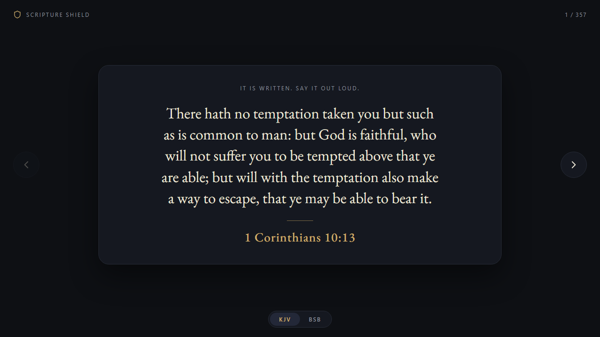
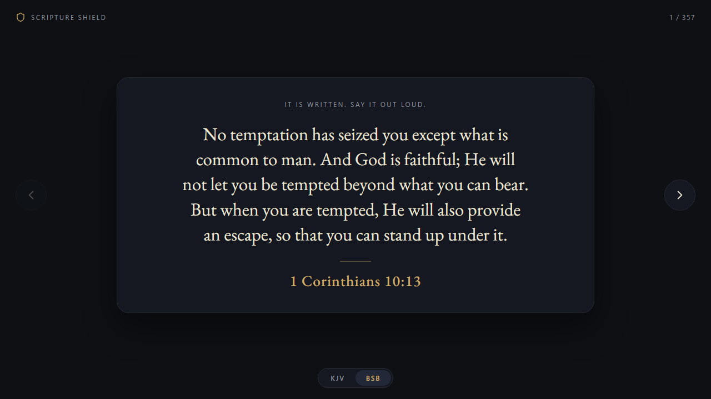

# Scripture Shield

Bible verses to quote out loud when you are being tempted. One passage at a time, a different order every launch, completely offline.

<p align="center">
  
  
</p>

> Submit yourselves therefore to God. Resist the devil, and he will flee from you. (James 4:7)

When Jesus was tempted in the wilderness, he answered every time with "It is written" and quoted scripture (Matthew 4). Scripture Shield puts a verse in front of you so you can do the same: read it slowly, out loud, and mean it.

## Features

- **357 hand-picked passages** on temptation, purity, guarding your eyes and mind, resisting the devil, self-control, strength, and forgiveness when you stumble. Single verses and short groups, always with book, chapter, and verse.
- **KJV and BSB.** Switch with the toggle at the bottom. Both translations are public domain, and your choice is remembered.
- **Random order every launch.** A full pass shows every passage once before reshuffling, so you do not see repeats until you have seen them all.
- **Forward and back arrows** to move through passages, with keyboard shortcuts.
- **Fully offline.** Every verse is baked into the app. Nothing is downloaded, nothing is sent anywhere, and there is no account.
- **Tiny and fast.** A single exe of about 7 MB that opens in under a second.
- **Opens maximized**, with F11 fullscreen.
- Text size adapts to the length of the passage, and the layout works down to narrow windows.

## Controls

| Action | Keys |
| --- | --- |
| Next passage | Right arrow, Space, Enter, Page Down |
| Previous passage | Left arrow, Backspace, Page Up |
| Fullscreen | F11 |
| Leave fullscreen | F11 or Esc |

## Requirements

Windows 10 or 11 (64-bit) with the Microsoft Edge WebView2 Runtime. It is built into Windows 11 and most up-to-date Windows 10 PCs. If it is missing, the app tells you where to get it.

## Build from source

You need [Go](https://go.dev/dl/), [Node.js](https://nodejs.org/), and PowerShell.

```powershell
git clone https://github.com/andrewplatania/scripture-shield.git
cd scripture-shield
.\go\build.ps1
```

The script generates the verse data, embeds the interface, and writes `dist\ScriptureShield.exe`. It installs [go-winres](https://github.com/tc-hib/go-winres) on first run if you do not have it.

## Change the verses

Passages live in `tools/refs.txt`, one per line:

```
Philippians 4:13
Matthew 5:27-28
1 Corinthians 10:13
```

Use full book names exactly as in the existing list, and a dash for ranges. Rebuild and your changes show up in both translations. The build stops with a clear error if a reference does not exist.

## How it works

A small Go program serves the embedded interface on a loopback address and shows it in a native WebView2 window. The interface is plain HTML, CSS, and JavaScript with no frameworks. At build time `tools/build-verses.js` reads the reference list and pulls the exact text from the KJV and BSB files in `data/`, then writes `src/verses.js`.

```
data/    KJV and BSB source text
src/     interface (HTML, CSS, JS, fonts)
tools/   reference list and verse builder
go/      native launcher and build script
docs/    screenshots
```

## Translations and credits

- **King James Version.** Public domain. Text from [thiagobodruk/bible](https://github.com/thiagobodruk/bible).
- **Berean Standard Bible.** The Holy Bible, Berean Standard Bible, BSB is produced in cooperation with Bible Hub, Discovery Bible, unfoldingWord, Bible Aquifer, OpenBible.com, and the Berean Bible Translation Committee. This text of God's Word has been dedicated to the public domain. Text from [BereanBible.com](https://berean.bible).
- **EB Garamond** typeface, SIL Open Font License 1.1. See `src/fonts/OFL.txt`.
- **[go-webview2](https://github.com/jchv/go-webview2)** by John Chadwick, MIT.

## License

The code is released under the [MIT License](LICENSE). The scripture texts are public domain as described above.
